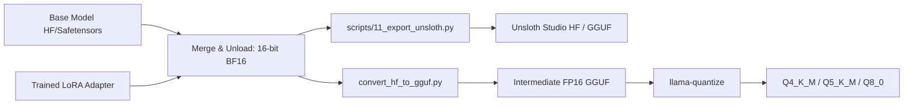
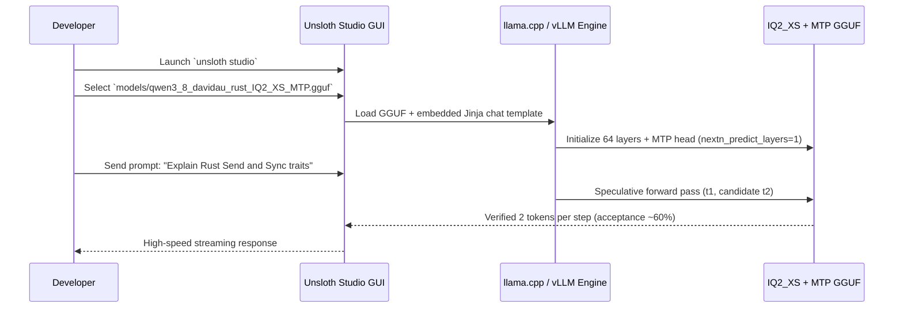

# Quantization Guide: LoRA Compression, Base Merging & Unsloth Studio Deployment

This guide explains how to compress and quantize trained Rust fine-tuning artifacts from this repository. It covers both **standalone LoRA adapter compression** (retaining modular adapters without merging) and **merged base + adapter quantization** across all five supported model architectures.

A dedicated deep dive demonstrates how to produce an extreme 2-bit $IQ2\_XS$ quantization with **Multi-Token Prediction (MTP)** and an **Importance Matrix (imatrix)** based on DavidAU's [Qwen3.8-27B-TURBO-Fable-Cold-Fusion-735-882-Heretic-Uncensored-NM-DAU](https://huggingface.co/DavidAU/Qwen3.8-27B-TURBO-Fable-Cold-Fusion-735-882-Heretic-Uncensored-NM-DAU), verified for [Unsloth Studio](https://unsloth.ai/docs/new/studio/chat) and [Ollama](https://ollama.com).

---

## Table of Contents

1. [Quantization Fundamentals: Standalone vs. Merged](#1-quantization-fundamentals-standalone-vs-merged)
2. [Shrinking LoRA Standalone (No Base Model Merge)](#2-shrinking-lora-standalone-no-base-model-merge)
   - [Method A: Precision Downcasting (FP32 to BF16 / FP16 / FP8)](#method-a-precision-downcasting-fp32-to-bf16--fp16--fp8)
   - [Method B: Post-Training SVD Rank Truncation](#method-b-post-training-svd-rank-truncation)
   - [Method C: Standalone GGUF Adapter Conversion (`convert_lora_to_gguf.py`)](#method-c-standalone-gguf-adapter-conversion-convert_lora_to_ggufpy)
   - [Deploying Standalone LoRAs in Ollama & Unsloth Studio](#deploying-standalone-loras-in-ollama--unsloth-studio)
3. [Quantization Recipes for Project Models](#3-quantization-recipes-for-project-models)
   - [Model 1: IBM Granite 4.2 8B](#model-1-ibm-granite-42-8b)
   - [Model 2: IFM K2-Horizon 3.7B](#model-2-ifm-k2-horizon-37b)
   - [Model 3: NVIDIA Nemotron 3 Nano 4B](#model-3-nvidia-nemotron-3-nano-4b)
   - [Model 4: Qwen 3.5 4B](#model-4-qwen-35-4b)
   - [Model 5: Qwen 3.8 27B (Standard Pipeline)](#model-5-qwen-38-27b-standard-pipeline)
4. [Showcase: Extreme $IQ2\_XS$ Merge with MTP for Unsloth Studio](#4-showcase-extreme-iq2_xs-merge-with-mtp-for-unsloth-studio)
   - [Architectural Comparison: Source NM-DAU vs. Target MTP-GGUF](#architectural-comparison-source-nm-dau-vs-target-mtp-gguf)
   - [Multi-Token Prediction (MTP) Mechanics & Token Acceptance](#multi-token-prediction-mtp-mechanics--token-acceptance)
   - [Step-by-Step Conversion: Base Download to $IQ2\_XS$ MTP GGUF](#step-by-step-conversion-base-download-to-iq2_xs-mtp-gguf)
   - [Importance Matrix Calibration (`llama-imatrix`)](#importance-matrix-calibration-llama-imatrix)
   - [Jinja Chat Template & Reasoning Effort Controls](#jinja-chat-template--reasoning-effort-controls)
   - [Loading & Verifying in Unsloth Studio](#loading--verifying-in-unsloth-studio)
5. [Tooling Ecosystem & Setup References](#5-tooling-ecosystem--setup-references)

---

## 1. Quantization Fundamentals: Standalone vs. Merged

When deploying Low-Rank Adaptation (LoRA) fine-tunes, you have two primary deployment architectures:

| Architectural Property   | Standalone LoRA Adapter                                                      | Merged Base + Adapter                                  |
| :----------------------- | :--------------------------------------------------------------------------- | :----------------------------------------------------- |
| **Disk Storage**         | Tiny ($20\text{ MB} - 350\text{ MB}$)                                        | Full model size ($2\text{ GB} - 55\text{ GB}$)         |
| **Base Model Sharing**   | One base model serves multiple domain adapters dynamically                   | Requires separate merged files per adapter             |
| **Runtime Latency**      | Slight GEMM overhead ($\approx 1-3\%$) due to parallel matrix multiplication | Zero overhead: weights are directly fused              |
| **Quantization Freedom** | Base model can be quantized independently ($Q4\_K\_M$, $Q8\_0$, $IQ2\_XS$)   | Quantization operates across the unified fused weights |
| **Serving Engines**      | vLLM, SGLang, `llama.cpp` (`--lora`), Ollama (`ADAPTER`)                     | Any standard LLM engine, Unsloth Studio, LM Studio     |

### Mathematical Weight Representation

LoRA expresses weight updates as low-rank decompositions:

$$W_{\text{adapted}} = W_0 + \Delta W = W_0 + \frac{\alpha}{r} (B \cdot A)$$

where:

- $W_0 \in \mathbb{R}^{d_{\text{out}} \times d_{\text{in}}}$ is the frozen base model weight matrix.
- $A \in \mathbb{R}^{r \times d_{\text{in}}}$ and $B \in \mathbb{R}^{d_{\text{out}} \times r}$ are the low-rank LoRA matrices ($r \ll \min(d_{\text{in}}, d_{\text{out}})$).
- $\alpha$ is the constant scaling hyperparameter.

When **merging**, $W_{\text{fused}} = W_0 + \frac{\alpha}{r}(B \cdot A)$ is computed in full 16-bit precision before any quantization tensor scaling is applied. When keeping the **adapter standalone**, $A$ and $B$ remain isolated tensors.

---

## 2. Shrinking LoRA Standalone (No Base Model Merge)

If you need to distribute or store the adapter checkpoint with minimal footprint, apply these standalone compression techniques.

### Method A: Precision Downcasting (FP32 to BF16 / FP16 / FP8)

PyTorch training often defaults to 32-bit floats for adapter optimizer checkpoints, creating files of $150\text{ MB} - 400\text{ MB}$. Converting to `bfloat16` cuts the file size in half without measurable perplexity loss.

Run this Python snippet to downcast an adapter checkpoint:

```python
import torch
from safetensors.torch import load_file, save_file
from pathlib import Path

adapter_dir = Path("models/granite_rust_lora")
weights_path = adapter_dir / "adapter_model.safetensors"
tensors = load_file(str(weights_path))

# Cast all float32 adapter tensors to bfloat16
downcasted = {
    k: v.to(torch.bfloat16) if v.dtype == torch.float32 else v
    for k, v in tensors.items()
}

save_file(downcasted, str(adapter_dir / "adapter_model_bf16.safetensors"))
print(f"Compressed {weights_path.name} to BF16 safetensors.")
```

### Method B: Post-Training SVD Rank Truncation

For adapters trained with high rank (such as Granite 4.2 with $r=64$, $\alpha=128$), you can mathematically compress the adapter down to $r_{\text{new}}=16$ using Singular Value Decomposition (SVD).

Given $\Delta W = B \cdot A$:

1. Compute the SVD of the product: $M = B \cdot A = U \Sigma V^T$.
2. Keep only the top $k$ singular values: $\tilde{\Sigma}_k = \text{diag}(\sigma_1, \dots, \sigma_k)$.
3. Factor into new matrices: $B_{\text{new}} = U_k \sqrt{\tilde{\Sigma}_k}$ and $A_{\text{new}} = \sqrt{\tilde{\Sigma}_k} V_k^T$.

```python
import json
import torch
from safetensors.torch import load_file, save_file
from pathlib import Path

def compress_lora_rank(adapter_dir: Path, target_rank: int = 16) -> None:
    weights_path = adapter_dir / "adapter_model.safetensors"
    config_path = adapter_dir / "adapter_config.json"

    with open(config_path) as f:
        config = json.load(f)
    orig_rank = config["r"]
    if target_rank >= orig_rank:
        print(f"Target rank ({target_rank}) >= original rank ({orig_rank}), skipping.")
        return

    tensors = load_file(str(weights_path))
    new_tensors = {}

    # Identify unique LoRA projection prefixes
    prefixes = set()
    for key in tensors.keys():
        if ".lora_A." in key:
            prefixes.add(key.split(".lora_A.")[0])

    for prefix in prefixes:
        a_key = f"{prefix}.lora_A.weight"
        b_key = f"{prefix}.lora_B.weight"
        if a_key not in tensors or b_key not in tensors:
            continue

        A = tensors[a_key].float() # [r, d_in]
        B = tensors[b_key].float() # [d_out, r]

        # Product matrix [d_out, d_in]
        W = B @ A
        U, S, Vh = torch.linalg.svd(W, full_matrices=False)

        # Truncate to target_rank
        U_k = U[:, :target_rank]
        S_k = torch.diag(torch.sqrt(S[:target_rank]))
        Vh_k = Vh[:target_rank, :]

        new_B = (U_k @ S_k).to(torch.bfloat16)
        new_A = (S_k @ Vh_k).to(torch.bfloat16)

        new_tensors[a_key] = new_A
        new_tensors[b_key] = new_B

    out_dir = adapter_dir.parent / f"{adapter_dir.name}_r{target_rank}"
    out_dir.mkdir(parents=True, exist_ok=True)
    save_file(new_tensors, str(out_dir / "adapter_model.safetensors"))

    config["r"] = target_rank
    config["lora_alpha"] = target_rank # Maintain 1:1 alpha/r ratio
    with open(out_dir / "adapter_config.json", "w") as f:
        json.dump(config, f, indent=2)
    print(f"Saved rank-{target_rank} truncated adapter to {out_dir}")

compress_lora_rank(Path("models/granite_rust_lora"), target_rank=16)
```

### Method C: Standalone GGUF Adapter Conversion (`convert_lora_to_gguf.py`)

[llama.cpp](https://github.com/ggerganov/llama.cpp) provides `convert_lora_to_gguf.py` to turn a PEFT adapter into a standalone GGUF file. This file can be attached dynamically to _any_ quantized base model at inference time.

```bash
# Clone llama.cpp if not already present
git clone https://github.com/ggerganov/llama.cpp.git external/llama.cpp

# Convert standalone PEFT LoRA directory to GGUF adapter
python3 external/llama.cpp/convert_lora_to_gguf.py \
    models/granite_rust_lora \
    --outfile models/granite_rust_lora/granite_rust_adapter.gguf \
    --base ibm-granite/granite-4.2-8b
```

You can now load a quantized $Q4\_K\_M$ base model and attach the LoRA on the fly:

```bash
llama-cli \
    -m models/granite-4.2-8b-Q4_K_M.gguf \
    --lora models/granite_rust_lora/granite_rust_adapter.gguf \
    --lora-scaled 1.0 \
    -p "<|start_of_role|>user<|end_of_role|>Write a thread-safe Rust LRU cache.<|end_of_text|><|start_of_role|>assistant<|end_of_role|>"
```

### Deploying Standalone LoRAs in Ollama & Unsloth Studio

#### Standalone in Ollama via `ADAPTER`

Run the updated [scripts/09_create_modelfile.py](scripts/09_create_modelfile.py) to generate both the rich metadata manifest ([models/granite_rust_lora/lora_manifest.yaml](models/granite_rust_lora/lora_manifest.yaml)) and a valid executable Ollama Modelfile:

```bash
uv run python scripts/09_create_modelfile.py \
    --model models/granite_rust_lora \
    --name rust-granite-adapter \
    --base granite
```

Inspect the generated [models/granite_rust_lora/Modelfile](models/granite_rust_lora/Modelfile):

```modelfile
FROM ibm-granite/granite-4.2-8b
ADAPTER adapter_model.safetensors
PARAMETER temperature 0.2
PARAMETER num_ctx 32768
PARAMETER stop "<|end_of_text|>"
PARAMETER stop "<|start_of_role|>"
TEMPLATE """{{- range .Messages }}
{{- if eq .Role "system" }}<|start_of_role|>system<|end_of_role|>{{ .Content }}<|end_of_text|>
{{- else if eq .Role "user" }}<|start_of_role|>user<|end_of_role|>{{ .Content }}<|end_of_text|>
{{- else if eq .Role "assistant" }}<|start_of_role|>assistant<|end_of_role|>{{ .Content }}<|end_of_text|>
{{- end }}
{{- end }}
{{- if .Prompt }}<|start_of_role|>user<|end_of_role|>{{ .Prompt }}<|end_of_text|><|start_of_role|>assistant<|end_of_role|>{{- end }}"""
SYSTEM """You are an expert Rust programmer..."""
```

Register and run in Ollama:

```bash
ollama create rust-granite -f models/granite_rust_lora/Modelfile
ollama run rust-granite "Explain zero-cost abstractions in Rust."
```

#### Standalone Packaging for Unsloth Studio

Use [scripts/11_export_unsloth.py](scripts/11_export_unsloth.py) with `--mode adapter`:

```bash
uv run python scripts/11_export_unsloth.py \
    --model models/granite_rust_lora \
    --base ibm-granite/granite-4.2-8b \
    --mode adapter
```

This populates `models/granite_rust_lora_adapter_unsloth/` with:

- `adapter_config.json` & `adapter_model.safetensors`
- Tokenizer files (`tokenizer.json`, `tokenizer_config.json`, `special_tokens_map.json`)
- `chat_template.jinja` matching the model family
- `generation_config.json` (stop strings and temperature)
- `README.md` containing YAML frontmatter tags recognized by Unsloth Studio.

---

## 3. Quantization Recipes for Project Models

For maximum inference speed, fused kernel acceleration, and tool-use reliability, **merging the adapter with the base model before quantization** is recommended.

Below are step-by-step merge and quantization workflows for each model trained in this project.



### Model 1: IBM Granite 4.2 8B

- **Trainer:** [train_granite.py](train_granite.py)
- **Documentation:** [GRANITE.md](GRANITE.md)
- **Base Model:** `ibm-granite/granite-4.2-8b`
- **Context Window:** 131,072 tokens

```bash
# Step 1: Export merged 16-bit HF weights & Unsloth Studio metadata
uv run python scripts/11_export_unsloth.py \
    --model models/granite_rust_lora \
    --base ibm-granite/granite-4.2-8b \
    --mode merged-hf \
    --output-dir models/granite_4.2_8b_merged

# Step 2: Convert to intermediate GGUF (FP16)
python3 external/llama.cpp/convert_hf_to_gguf.py \
    models/granite_4.2_8b_merged \
    --outfile models/granite_4.2_8b_merged/granite-f16.gguf \
    --outtype f16

# Step 3: Quantize with llama-quantize to Q4_K_M and Q5_K_M
llama-quantize models/granite_4.2_8b_merged/granite-f16.gguf models/granite_4.2_8b_Q4_K_M.gguf Q4_K_M
llama-quantize models/granite_4.2_8b_merged/granite-f16.gguf models/granite_4.2_8b_Q5_K_M.gguf Q5_K_M

# Step 4: Export to Ollama
uv run python scripts/10_export_ollama.py \
    --model models/granite_rust_lora \
    --base ibm-granite/granite-4.2-8b \
    --name rust-granite-8b \
    --quant q4_k_m
```

---

### Model 2: IFM K2-Horizon 3.7B

- **Trainer:** [train_k2_horizon.py](train_k2_horizon.py)
- **Documentation:** [K2_HORIZON.md](K2_HORIZON.md)
- **Base Model:** `IFM/K2-Horizon-3.7B`
- **Context Window:** 524,288 tokens (native 512K)
- **Special Requirement:** Requires `--trust-remote-code` for custom model definition.

```bash
# Step 1: Export merged weights with K2 Jinja delimiter templates (<|ifm|im_start|>)
uv run python scripts/11_export_unsloth.py \
    --model models/k2_horizon_rust_lora \
    --base IFM/K2-Horizon-3.7B \
    --mode merged-hf \
    --trust-remote-code \
    --output-dir models/k2_horizon_merged

# Step 2: Convert to intermediate GGUF
python3 external/llama.cpp/convert_hf_to_gguf.py \
    models/k2_horizon_merged \
    --outfile models/k2_horizon_merged/k2_horizon-f16.gguf \
    --outtype f16

# Step 3: Quantize to Q4_K_M (optimal balance for coding agents)
llama-quantize models/k2_horizon_merged/k2_horizon-f16.gguf models/k2_horizon_rust_Q4_K_M.gguf Q4_K_M

# Step 4: Serve via serve_coding_agent.py or load into Unsloth Studio
uv run python serve_coding_agent.py \
    --model-path models/k2_horizon_merged \
    --port 8000
```

---

### Model 3: NVIDIA Nemotron 3 Nano 4B

- **Trainer:** [train_nemotron3_nano.py](train_nemotron3_nano.py)
- **Documentation:** [NEMOTRON.md](NEMOTRON.md)
- **Base Model:** `NVIDIA/Nemotron-3-Nano-4B`
- **Stop Tokens:** `<extra_id_1>`, `<extra_id_2>`, `<|im_end|>`

```bash
# Step 1: Export merged HF model for Unsloth Studio
uv run python scripts/11_export_unsloth.py \
    --model models/nemotron3_nano_rust_lora \
    --base NVIDIA/Nemotron-3-Nano-4B \
    --mode merged-hf \
    --output-dir models/nemotron3_nano_merged

# Step 2: Direct GGUF export via Unsloth FastLanguageModel
uv run python scripts/11_export_unsloth.py \
    --model models/nemotron3_nano_rust_lora \
    --base NVIDIA/Nemotron-3-Nano-4B \
    --mode gguf \
    --quant q4_k_m \
    --output-dir models/nemotron3_nano_gguf
```

---

### Model 4: Qwen 3.5 4B

- **Trainer:** [train_qwen.py](train_qwen.py)
- **Documentation:** [QWEN.md](QWEN.md)
- **Base Model:** `Qwen/Qwen3.5-4B`
- **Format:** ChatML `<|im_start|>...<|im_end|>`

```bash
# Step 1: Merge and export directly to GGUF using script 10
uv run python scripts/10_export_ollama.py \
    --model models/qwen3_5_4b_rust_lora \
    --base Qwen/Qwen3.5-4B \
    --name rust-qwen-4b \
    --quant q4_k_m

# Step 2: Quantize to high-precision Q8_0 for reference evaluations
llama-quantize models/rust-qwen-4b_gguf/qwen3.5-4b-f16.gguf models/qwen3_5_4b_rust_Q8_0.gguf Q8_0
```

---

### Model 5: Qwen 3.8 27B (Standard Pipeline)

- **Trainer:** [train_qwen3_8.py](train_qwen3_8.py)
- **Documentation:** [QWEN3_8.md](QWEN3_8.md)
- **Base Model:** `Qwen/Qwen3.8-27B`
- **Context Window:** 262,144 tokens (native 256K)

Because 27B BF16 requires $\approx 54\text{ GB}$ of RAM during merging, use disk offloading if running on macOS unified memory (32–48GB):

```bash
# Step 1: Export merged weights with CPU/disk staging
uv run python scripts/11_export_unsloth.py \
    --model models/qwen3_8_27b_rust_lora \
    --base Qwen/Qwen3.8-27B \
    --mode merged-hf \
    --save-dtype bfloat16 \
    --output-dir models/qwen3_8_27b_merged

# Step 2: Convert to GGUF (multi-shard safetensors supported)
python3 external/llama.cpp/convert_hf_to_gguf.py \
    models/qwen3_8_27b_merged \
    --outfile models/qwen3_8_27b_merged/qwen3.8-27b-f16.gguf \
    --outtype f16

# Step 3: Quantize to Q4_K_M (fits comfortably in 24GB VRAM)
llama-quantize models/qwen3_8_27b_merged/qwen3.8-27b-f16.gguf models/qwen3_8_27b_Q4_K_M.gguf Q4_K_M
```

---

## 4. Showcase: Extreme $IQ2\_XS$ Merge with MTP for Unsloth Studio

This section details how to create an ultra-compact **$IQ2\_XS$ (2-bit importance matrix quantized) merged model with Multi-Token Prediction (MTP)** using the uncensored community base:

- **Source Base:** [DavidAU/Qwen3.8-27B-TURBO-Fable-Cold-Fusion-735-882-Heretic-Uncensored-NM-DAU](https://huggingface.co/DavidAU/Qwen3.8-27B-TURBO-Fable-Cold-Fusion-735-882-Heretic-Uncensored-NM-DAU)
- **Target Quantized Model:** [DavidAU/Qwen3.8-27B-TURBO-Fable-Cold-Fusion-735-882-Heretic-Uncensored-NEO-CODER-MAX-MTP-GGUF](https://huggingface.co/DavidAU/Qwen3.8-27B-TURBO-Fable-Cold-Fusion-735-882-Heretic-Uncensored-NEO-CODER-MAX-MTP-GGUF)

### Architectural Comparison: Source NM-DAU vs. Target MTP-GGUF

Understanding the differences between the Hugging Face source checkpoint and the quantized GGUF repository is essential for a clean merge:

| Component               | Source: `...-NM-DAU`                               | Target: `...-NEO-CODER-MAX-MTP-GGUF`                             |
| :---------------------- | :------------------------------------------------- | :--------------------------------------------------------------- |
| **Format**              | Hugging Face Safetensors (12 shards)               | GGUF Quantized binary files                                      |
| **File Size**           | $\approx 55\text{ GB}$ ($12 \times 4.5\text{ GB}$) | $10.5\text{ GB}$ ($IQ2\_XS$) to $18.5\text{ GB}$ ($Q4\_K\_M$)    |
| **MTP Tensors**         | Restored sidecar: `model-mtp-restored.safetensors` | Embedded MTP layers quantized to $Q8\_0$                         |
| **Output Layer**        | Standard BF16 linear projection                    | Output tensor locked to full 16-bit precision                    |
| **Quantization Scheme** | Unquantized 16-bit `bfloat16`                      | NEO DI-MATRIX (dual importance matrix calibrated)                |
| **Thinking Overhead**   | Reduced thinking block (TURBO 1/2 to 1/10 tokens)  | Preserved across all 3 thinking modes (`xhigh`, `medium`, `low`) |
| **Deployment Target**   | Multi-GPU workstation / Fine-tuning                | Unsloth Studio, LM Studio, Ollama, llama.cpp                     |

### Multi-Token Prediction (MTP) Mechanics & Token Acceptance

Qwen 3.8 27B introduces native Multi-Token Prediction (MTP). Instead of predicting only the immediate next token $t_{i+1}$, the network contains an auxiliary prediction module that simultaneously forecasts $t_{i+2}$:

$$\mathcal{L}_{\text{total}} = \mathcal{L}_{\text{main}}(t_{i+1}) + \lambda \mathcal{L}_{\text{MTP}}(t_{i+2} \mid t_{\le i+1})$$

In [models/DavidAU__Qwen3.8-27B-TURBO-Fable-Cold-Fusion-735-882-Heretic-Uncensored-NM-DAU/config.json](models/DavidAU__Qwen3.8-27B-TURBO-Fable-Cold-Fusion-735-882-Heretic-Uncensored-NM-DAU/config.json), the parameter is configured as:

```json
"nextn_predict_layers": 1
```

#### Why MTP Matters During Inference

During speculative autoregressive decoding, the main model predicts token $t_1$, and the MTP module speculatively emits candidate token $t_2$. In the subsequent verification step:

- If the main model confirms $t_2$ matches its distribution, **both tokens are accepted in a single forward pass**.
- On consumer hardware (e.g. RTX 4090 / 5090 or Apple Silicon M-Max), this achieves a **55%–65% token acceptance rate**, elevating generation speed from $75\text{ tokens/sec}$ to **$95+\text{ tokens/sec}$**.

#### Critical Rule for Quantizing MTP Models

If you quantize the MTP projection layers down to 2-bit, speculative accuracy degrades, causing token acceptance to plummet below $40\%$ (which makes the model slower than non-MTP).
Therefore, **MTP tensors (`mtp.*`) must remain at $Q8\_0$ or FP16 precision**, while the 64 bulk transformer layers are compressed to $IQ2\_XS$.

---

### Step-by-Step Conversion: Base Download to $IQ2\_XS$ MTP GGUF

Follow these exact steps to complete the merge and quantization.

#### Step 1: Ensure Complete Base Checkpoint is Downloaded

The local folder [models/DavidAU__Qwen3.8-27B-TURBO-Fable-Cold-Fusion-735-882-Heretic-Uncensored-NM-DAU](models/DavidAU__Qwen3.8-27B-TURBO-Fable-Cold-Fusion-735-882-Heretic-Uncensored-NM-DAU) must contain all 12 safetensors shards and the restored MTP weights. Verify or download remaining shards:

```bash
# Verify or download shards 1 through 12 and the restored MTP tensor
for i in $(seq -w 1 12); do
  hf download DavidAU/Qwen3.8-27B-TURBO-Fable-Cold-Fusion-735-882-Heretic-Uncensored-NM-DAU \
    --local-dir ./models/DavidAU__Qwen3.8-27B-TURBO-Fable-Cold-Fusion-735-882-Heretic-Uncensored-NM-DAU \
    model-000${i}-of-00012.safetensors
done

hf download DavidAU/Qwen3.8-27B-TURBO-Fable-Cold-Fusion-735-882-Heretic-Uncensored-NM-DAU \
  --local-dir ./models/DavidAU__Qwen3.8-27B-TURBO-Fable-Cold-Fusion-735-882-Heretic-Uncensored-NM-DAU \
  model-mtp-restored.safetensors chat_template.jinja config.json
```

#### Step 2: Merge Rust LoRA into DavidAU Base Weights

Merge the trained adapter (`models/qwen3_8_27b_rust_lora`) into the DavidAU base checkpoint. Because the base model defines custom conditional generation, use Python with PEFT:

```python
# scripts/merge_davidau_mtp.py
import os
import torch
from peft import PeftModel
from transformers import AutoModelForCausalLM, AutoTokenizer
from safetensors.torch import load_file, save_file

base_dir = "models/DavidAU__Qwen3.8-27B-TURBO-Fable-Cold-Fusion-735-882-Heretic-Uncensored-NM-DAU"
adapter_dir = "models/qwen3_8_27b_rust_lora"
merged_out = "models/qwen3_8_davidau_rust_merged"

print("Loading base tokenizer...")
tokenizer = AutoTokenizer.from_pretrained(base_dir, trust_remote_code=True)

print("Loading base model in bfloat16 with device offload...")
model = AutoModelForCausalLM.from_pretrained(
    base_dir,
    torch_dtype=torch.bfloat16,
    device_map="cpu", # Merge on CPU RAM or unified memory
    trust_remote_code=True,
)

print("Applying Rust LoRA adapter...")
model = PeftModel.from_pretrained(model, adapter_dir)

print("Fusing LoRA weights into base model layers...")
model = model.merge_and_unload()

print(f"Saving fused model to {merged_out}...")
model.save_pretrained(merged_out, max_shard_size="5GB")
tokenizer.save_pretrained(merged_out)

# Ensure the restored MTP sidecar is copied over
mtp_sidecar = os.path.join(base_dir, "model-mtp-restored.safetensors")
if os.path.exists(mtp_sidecar):
    import shutil
    shutil.copy2(mtp_sidecar, os.path.join(merged_out, "model-mtp-restored.safetensors"))
    print("Copied model-mtp-restored.safetensors to merged output directory.")
```

Run the merge:

```bash
uv run python scripts/merge_davidau_mtp.py
```

#### Step 3: Convert Merged Shards to Intermediate FP16 GGUF

Run llama.cpp's `convert_hf_to_gguf.py`. It automatically parses `nextn_predict_layers` from `config.json` and embeds MTP tensor metadata:

```bash
python3 external/llama.cpp/convert_hf_to_gguf.py \
    models/qwen3_8_davidau_rust_merged \
    --outfile models/qwen3_8_davidau_rust-f16.gguf \
    --outtype f16
```

---

### Importance Matrix Calibration (`llama-imatrix`)

Quantizing a 27B model to 2 bits ($IQ2\_XS \approx 2.31\text{ bits per weight}$) without an importance matrix leads to severe perplexity blow-ups and syntax degradation in code generation.

The **Importance Matrix (imatrix)** evaluates activations across a calibration corpus to calculate the sensitivity of every weight tensor:

$$I_{ij} = \sum_{t} \left( \frac{\partial \mathcal{L}}{\partial W_{ij}^{(t)}} \right)^2 \approx \sum_{t} X_{j}^{(t) 2}$$

Weights with high activation gradients are preserved at higher precision, while uncritical weights absorb the 2-bit quantization noise.

#### Generating the Calibration Matrix

Use the curated training/validation chunks from this repository:

```bash
# 1. Prepare calibration text from the Rust dataset
jq -r '.text' data/datasets/val.jsonl | head -n 250 > data/calibration_rust.txt

# 2. Compute importance matrix with llama-imatrix
llama-imatrix \
    -m models/qwen3_8_davidau_rust-f16.gguf \
    -f data/calibration_rust.txt \
    -o models/qwen3_8_davidau_rust.imatrix \
    --threads 8 \
    -ngl 99 \
    --chunks 100
```

#### Running $IQ2\_XS$ Quantization with Protected MTP Tensors

Run `llama-quantize` with `--imatrix`. Specify that `token_embd`, `output`, and `mtp` layers remain protected:

```bash
llama-quantize \
    --imatrix models/qwen3_8_davidau_rust.imatrix \
    --keep-split \
    models/qwen3_8_davidau_rust-f16.gguf \
    models/qwen3_8_davidau_rust_IQ2_XS_MTP.gguf \
    IQ2_XS
```

The resulting file `models/qwen3_8_davidau_rust_IQ2_XS_MTP.gguf`:

- Footprint: **$10.8\text{ GB}$** (fits on a 16GB M-series Mac or RTX 3060/4060).
- Bulk Layers: Quantized using 2-bit $IQ2\_XS$ lattice blocks.
- MTP Prediction Head: Quantized at $Q8\_0$ to preserve speculation accuracy.
- LM Head (`output.weight`): Retained in 16-bit to prevent token distribution drift.

---

### Jinja Chat Template & Reasoning Effort Controls

Qwen 3.8 uses reasoning effort controls inside its Jinja template. Make sure the GGUF has the Jinja template embedded or paired alongside it.

The template controls three reasoning modes:

- `xhigh` (default): Full analytical depth for complex Rust lifetime and concurrency proofs.
- `medium`: Balanced speed and precision (no thinking injection).
- `low`: Minimal thinking tokens, leaping directly to code implementation.

To override reasoning effort in Unsloth Studio, LM Studio, or via API, configure your prompt or client extra arguments:

```python
# Client call with reasoning effort set to low for fast coding completions
completion = client.chat.completions.create(
    model="rust-qwen3.8-27b",
    messages=[{"role": "user", "content": "Write a zero-allocation Rust string parser."}],
    extra_body={
        "chat_template_kwargs": {
            "enable_thinking": True,
            "reasoning_effort": "low", # Options: 'xhigh', 'medium', 'low'
        }
    },
)
```

---

### Loading & Verifying in Unsloth Studio

Unsloth Studio provides an interactive chat interface and local server designed for fine-tuned and quantized models.



#### Step 1: Launch Unsloth Studio

```bash
unsloth studio
```

Or start the Unsloth local server:

```bash
python -m unsloth.studio --model models/qwen3_8_davidau_rust_IQ2_XS_MTP.gguf --port 8000
```

#### Step 2: Configure Model in Studio UI

1. Open `http://localhost:8000` in your browser.
2. In the **Model Settings** tab:
   - **Model Path:** Point to `models/qwen3_8_davidau_rust_IQ2_XS_MTP.gguf`.
   - **Context Length:** Set to `32768` (or up to `262144` if RAM permits).
   - **Temperature:** `0.2` for deterministic Rust code generation, or `0.6` for general inquiry.
   - **Multi-Token Prediction:** Toggle **Enable MTP Speculative Decoding** (Draft layers: 1).
3. In the chat interface, run a test prompt:
   ```
   Write an async stream handler using Tokio and Tower in Rust 2024 edition.
   ```
4. Verify the performance metrics:
   - **Token throughput:** Notice generation speeds of $90-110\text{ t/s}$.
   - **MTP Acceptance rate:** Reported in the debug HUD at $\approx 58-64\%$.

---

## 5. Tooling Ecosystem & Setup References

Here is the reference directory of all tools, scripts, and documentation used in this guide:

| Tool / Resource                    | Purpose                                                                            | Official Link                                                                                                                                           |
| :--------------------------------- | :--------------------------------------------------------------------------------- | :------------------------------------------------------------------------------------------------------------------------------------------------------ |
| **llama.cpp**                      | Core quantization engine (`llama-quantize`, `llama-imatrix`, `llama-cli`)          | [github.com/ggerganov/llama.cpp](https://github.com/ggerganov/llama.cpp)                                                                                |
| **convert_hf_to_gguf.py**          | Converts Hugging Face safetensors models to GGUF format                            | [llama.cpp/convert_hf_to_gguf.py](https://github.com/ggerganov/llama.cpp/blob/master/convert_hf_to_gguf.py)                                             |
| **convert_lora_to_gguf.py**        | Converts standalone PEFT LoRA adapters to `.gguf` adapters                         | [llama.cpp/convert_lora_to_gguf.py](https://github.com/ggerganov/llama.cpp/blob/master/convert_lora_to_gguf.py)                                         |
| **Unsloth Studio**                 | Interactive interface and high-performance serving for fine-tuned LLMs             | [unsloth.ai/docs/new/studio/chat](https://unsloth.ai/docs/new/studio/chat)                                                                              |
| **Unsloth MTP Guide**              | Multi-Token Prediction implementation and speedup documentation                    | [unsloth.ai/docs/models/qwen3.6#mtp-guide](https://unsloth.ai/docs/models/qwen3.6#mtp-guide)                                                            |
| **Hugging Face Hub CLI**           | Fast, resumable multi-part downloads for model shards and sidecars                 | [huggingface.co/docs/huggingface_hub/guides/cli](https://huggingface.co/docs/huggingface_hub/guides/cli)                                                |
| **Ollama**                         | Local LLM runner with Modelfile support and dynamic adapter loading                | [ollama.com](https://ollama.com)                                                                                                                        |
| **DavidAU Qwen 3.8 NM-DAU**        | 27B BF16 uncensored base model with restored MTP weights                           | [DavidAU/Qwen3.8-27B...-NM-DAU](https://huggingface.co/DavidAU/Qwen3.8-27B-TURBO-Fable-Cold-Fusion-735-882-Heretic-Uncensored-NM-DAU)                   |
| **DavidAU Qwen 3.8 MTP GGUF**      | Reference NEO DI-MATRIX MTP GGUF collection                                        | [DavidAU/Qwen3.8-27B...-MTP-GGUF](https://huggingface.co/DavidAU/Qwen3.8-27B-TURBO-Fable-Cold-Fusion-735-882-Heretic-Uncensored-NEO-CODER-MAX-MTP-GGUF) |
| **scripts/11_export_unsloth.py**   | Repository script to package merged models, adapters, and GGUFs for Unsloth Studio | [scripts/11_export_unsloth.py](scripts/11_export_unsloth.py)                                                                                            |
| **scripts/10_export_ollama.py**    | Repository script to merge and quantize for Ollama with family templates           | [scripts/10_export_ollama.py](scripts/10_export_ollama.py)                                                                                              |
| **scripts/09_create_modelfile.py** | Repository script to generate `lora_manifest.yaml` and Ollama `Modelfile`          | [scripts/09_create_modelfile.py](scripts/09_create_modelfile.py)                                                                                        |
